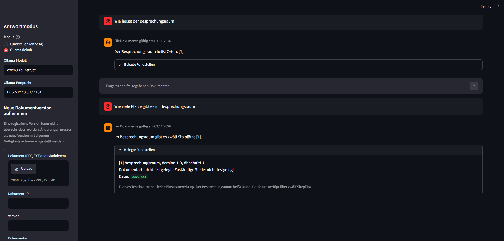

# Wissensassistent Feuerwehrleitstelle

Lokaler Wissensassistent zur Suche in Feuerwehrdokumenten mit Dokumentenverwaltung, Versionskontrolle und optionaler KI-gestützter Antwortgenerierung.



## Projekt

Dieses Projekt entwickelt einen Wissensassistenten für die Feuerwehr der Stadt Krefeld.

Ziel ist es, Mitarbeitenden einer Feuerwehrleitstelle den Zugriff auf Informationen aus verschiedenen Dokumenten zu erleichtern. Dazu gehören beispielsweise Dienstanweisungen, Alarm- und Ausrückeordnungen (AAO), Standard Operating Procedures (SOPs), Checklisten und Katastrophenschutzkonzepte.

Das System ermöglicht die Suche nach relevanten Informationen und zeigt die dazugehörigen Dokumentquellen und Fundstellen an. Optional können die gefundenen Textstellen mithilfe eines lokal ausgeführten Sprachmodells von Ollama zu einer Antwort zusammengefasst werden.

Ein besonderer Schwerpunkt liegt auf der Verwaltung von Dokumentversionen und Gültigkeitszeiträumen, damit nur zum jeweiligen Zeitpunkt gültige und freigegebene Dokumente als Informationsgrundlage verwendet werden.

## Features

- Import von PDF-, TXT- und Markdown-Dateien
- Suche nach passenden Textstellen in lokalen Dokumenten
- Optionale Antwortgenerierung mit einem lokalen Ollama-Modell
- Anzeige von Dokumentart, zuständiger Stelle, Version und Fundstelle
- Verwaltung von Dokumentversionen mit SQLite
- Berücksichtigung von Dokumentstatus und Gültigkeitszeiträumen
- Vermeidung überlappender Gültigkeitszeiträume freigegebener Versionen
- Prüfprotokoll mit Gültigkeitsstichtag, verwendeten Textstellen und Quellenhashes
- Lokale Speicherung der Dokumentinformationen und Suchvorgänge

## Inhaltsverzeichnis

- [Voraussetzungen](#voraussetzungen)
- [Installation](#installation)
- [Anwendung starten](#anwendung-starten)
- [Ollama konfigurieren](#ollama-konfigurieren)
- [Tests](#tests)
- [Projektstruktur](#projektstruktur)
- [Dokumentverwaltung und Nachvollziehbarkeit](#dokumentverwaltung-und-nachvollziehbarkeit)

## Voraussetzungen

- Python 3.11 oder neuer
- `pip` zur Installation der Python-Bibliotheken
- Git zum Klonen des Repositorys
- **Optional:** Ollama für die KI-gestützte Antwortgenerierung (für die reine Suche nach Fundstellen ist keine Ollama-Installation erforderlich)

## Installation

### Repository klonen
```bash
git clone https://github.com/bakricr8-cmd/Wissensassistent-Feuerwehrleitstelle
cd Wissensassistent-Feuerwehrleitstelle
```

### Virtuelle Umgebung erstellen

#### Windows (PowerShell)
```powershell
python -m venv .venv
.\.venv\Scripts\Activate.ps1
```

#### macOS / Linux
```bash
python3 -m venv .venv
source .venv/bin/activate
```

### Bibliotheken installieren
```bash
python -m pip install -r requirements.txt
```

## Anwendung starten

Bei aktivierter virtueller Umgebung kann die Anwendung mit folgendem Befehl gestartet werden:

```bash
streamlit run app.py
```

Die Benutzeroberfläche ist anschließend standardmäßig unter folgender Adresse erreichbar:  
[http://localhost:8501](http://localhost:8501)

Beim ersten Start werden die mitgelieferten Beispieldokumente aus dem Ordner `Dokumente/` anhand der Datei `metadaten.json` einmalig in die lokale SQLite-Datenbank übernommen.

## Ollama konfigurieren

Für die KI-gestützte Antwortgenerierung wird Ollama benötigt. Ollama ermöglicht die lokale Ausführung eines Sprachmodells.

### Ollama installieren
Ollama kann über folgende Webseite heruntergeladen werden:  
[https://ollama.com/download](https://ollama.com/download)

### Ollama starten
Falls Ollama nicht bereits automatisch im Hintergrund läuft, kann der Dienst über ein separates Terminal gestartet werden:

```bash
ollama serve
```

Der lokale Ollama-Dienst verwendet standardmäßig folgenden Endpunkt:
- **URL:** `http://127.0.0.1:11434`
- **Port:** `11434`

### Sprachmodell herunterladen
Als Standardmodell ist `qwen3:4b-instruct` in der Anwendung hinterlegt. Das Modell kann mit folgendem Befehl heruntergeladen werden:

```bash
ollama pull qwen3:4b-instruct
```

Nach dem Download kann in der Streamlit-Oberfläche im Seitenbereich der Modus **Ollama (lokal)** ausgewählt werden. Dort lassen sich sowohl das verwendete Modell als auch der Ollama-Endpunkt anpassen.

Alternativ steht der Modus **Fundstellen (ohne KI)** zur Verfügung. In diesem Modus werden passende Textstellen gesucht und angezeigt, ohne eine KI-Antwort zu generieren.

> **Datenschutzhinweis:** Aus Datenschutzgründen akzeptiert die Antwortgenerierung ausschließlich lokale HTTP-Endpunkte auf `localhost` oder einer Loopback-IP-Adresse.

## Tests

Die vorhandenen Tests können bei aktivierter virtueller Umgebung mit folgendem Befehl ausgeführt werden:

```bash
python -m unittest discover -s tests -v
```

Eine laufende Ollama-Instanz ist für die Tests nicht erforderlich.

Geprüft werden unter anderem:
- Dokumentversionen und Gültigkeitszeiträume
- Suche und Fundstellen
- Umgang mit unterschiedlichen Dokumentversionen
- Prüfprotokoll und Quellenzuordnung

## Projektstruktur

```text
Wissensassistent-Feuerwehrleitstelle/
│
├── app.py
├── requirements.txt
├── README.md
│
├── docs/
│   └── screenshot.png
│
├── src/
│   ├── __init__.py
│   ├── database.py
│   ├── document_loader.py
│   ├── document_search.py
│   ├── rag_pipeline.py
│   └── version_manager.py
│
├── Dokumente/
│   ├── ausleihe.txt
│   ├── schulung.txt
│   ├── schulung_alt.txt
│   ├── test.txt
│   └── metadaten.json
│
├── tests/
│   ├── test_rag.py
│   └── test_versions.py
│
├── UML/
│   ├── Aktivitätendiagramm.pdf
│   ├── Komponentendiagramm.pdf
│   └── Use Case Diagramm.pdf
│
└── data/
    └── wissensassistent.sqlite3
```

## Dokumentverwaltung und Nachvollziehbarkeit

Beim Import eines Dokuments werden unter anderem Dokument-ID, Dokumentart, zuständige Stelle, Versionsnummer, Status und Gültigkeitszeitraum erfasst.

Dokumente können als `freigegeben` oder `entwurf` gekennzeichnet werden. Freigegebene Versionen derselben Dokument-ID dürfen keine überlappenden Gültigkeitszeiträume besitzen.

Bei einer Anfrage wird geprüft, welche Dokumente zum jeweiligen Gültigkeitsstichtag verwendet werden dürfen. Die verwendeten Textstellen und Quellen werden zusammen mit den zugehörigen Dokumentinformationen protokolliert.

Zur Überprüfung der Datenintegrität werden SHA-256-Hashes verwendet. Damit lassen sich nachträgliche Änderungen an Dokumenten und Protokolleinträgen erkennen.
